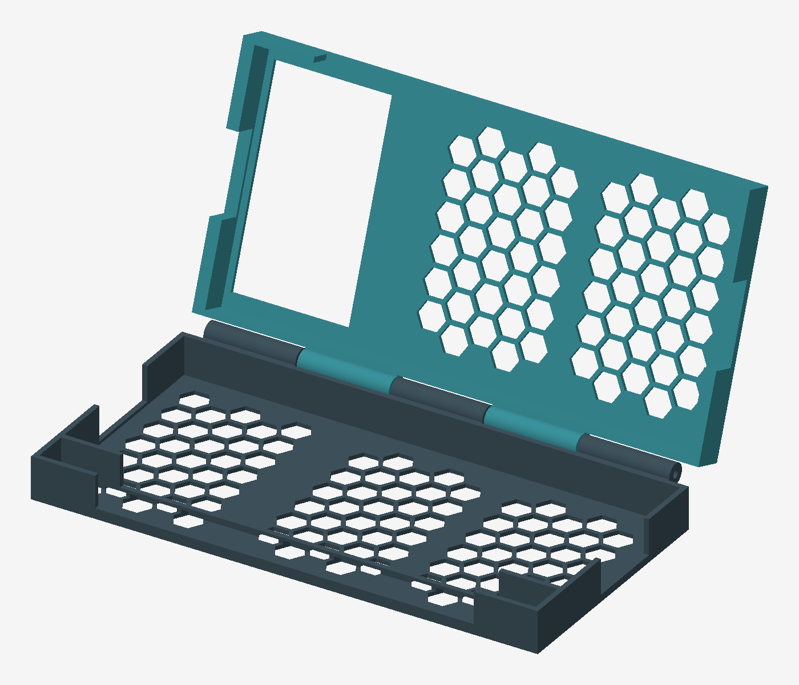
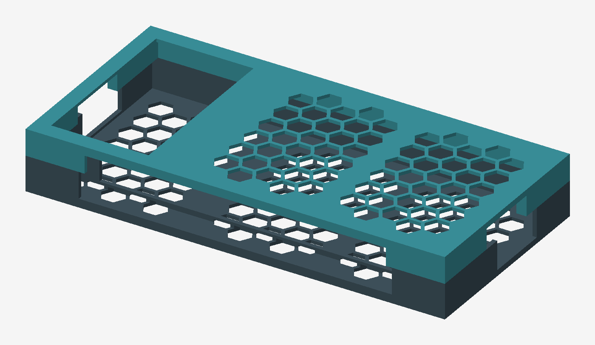

# iPhone 16e clamshell cyberdeck

**Current design: matching-size halves with hexagonal mesh backs and a camera opening.**

| Latest file | Preview | Download |
| --- | --- | --- |
| Open render | [View image](docs/hex-mesh-open.png) | [PNG](https://raw.githubusercontent.com/AidanJones/iphone_cyber_deck/main/docs/hex-mesh-open.png) |
| Closed render | [View image](docs/hex-mesh-closed.png) | [PNG](https://raw.githubusercontent.com/AidanJones/iphone_cyber_deck/main/docs/hex-mesh-closed.png) |
| Keyboard half | [3D model](print/keyboard_tray.stl) | [STL](https://raw.githubusercontent.com/AidanJones/iphone_cyber_deck/main/print/keyboard_tray.stl) |
| iPhone half | [3D model](print/phone_tray.stl) | [STL](https://raw.githubusercontent.com/AidanJones/iphone_cyber_deck/main/print/phone_tray.stl) |
| Open assembly | [GLB file](assembly.glb) | [GLB](https://raw.githubusercontent.com/AidanJones/iphone_cyber_deck/main/assembly.glb) |

The links above track the latest files on `main`. Both STL files include the
hexagonal mesh; the image previews below show those same generated models.

Printable prototype: landscape iPhone above a Rii keyboard, with the screen and
keys facing each other when closed. Two rigid trays, an interleaved pin hinge,
and removable adhesive retention. The minimal version measures **155 × 82.3 ×
22.8 mm closed**, excluding the phone's camera bump.

Compared with the first committed design, it is 7 mm thinner, 19.1 mm shallower,
and uses about 79% less solid mesh volume. It has 1.6 mm perimeter walls, 1.2 mm
back panels with a hexagonal lattice, solid mounting strips and 6.4 mm diameter
hinge barrels. Both halves share the same 155 × 75.5 mm outer rectangle, so the
front and side edges align when closed. The shorter keyboard has a hollow spacer
and an internal locator wall to preserve its fit. This is a light mounting frame
rather than a sealed protective enclosure.

See the [reference investigation](references/README.md) for the other makers'
designs, downloaded reference photographs, access limitations and comparison.

**Keyboard fit is provisional.** The original Amazon description does not identify
the model, and its short link could not be resolved. These STLs assume a **Rii K06,
151 × 59 × 11 mm**, not the wider i4/i8. Confirm the label and measure the actual
keyboard, including its highest keys, before printing the trays.





Renders show the current printable geometry without devices. The closed printed
envelope is 155 × 82.3 × 22.8 mm; the installed camera bump projects beyond it.
Both views regenerate with `uv run generate.py`.

## Print files

- [Keyboard tray](print/keyboard_tray.stl)
- [Phone tray](print/phone_tray.stl)
- [Keyboard footprint gauge](print/keyboard_fit_gauge.stl)
- [Phone footprint gauge](print/phone_fit_gauge.stl)
- [Hinge bore gauge](print/hinge_bore_gauge.stl)
- [Actual hinge print coupon](print/hinge_print_coupon.stl)
- [3D assembly preview](assembly.glb) — reference only, do not slice as a print plate.

## Printing and assembly

1. Print the three gauges first. The device should fit inside its gauge without
   force; these check the bounding rectangle, not corner contours or thickness.
   Check a 2 mm rod passes through the hinge gauge. Adjust clearance if needed.
   The hinge print coupon reproduces a short section of the actual rounded
   knuckle and its attachment, for testing support removal before the full print.
2. Print one of each tray with the broad outer back on the bed, pockets up, at
   100% scale in millimetres. Auto-arrange the phone tray (its Y coordinates start
   below zero). Auto-arrange both parts; each fits a 155 × 83 mm bed area before brim.
3. Suggested starting settings: PETG, 0.4 mm nozzle, 0.2 mm layers, four walls,
   five top/bottom layers, 20% infill. PLA is suitable for checking the fit.
   Enable build-plate supports beneath the rounded hinge undersides and their
   short webs. Use support painting if automatic supports enter the 2.4 mm bores;
   the bores should bridge without internal supports. Keep supports off the
   device-facing seats. Inspect the slicer preview and test the coupon.
4. Dry-fit the devices. The phone is bare, with its camera end toward the smaller
   end window. A 36 × 63.5 mm through-opening exposes the camera end, including
   space for the flash in either landscape orientation. Its generous coverage
   avoids assuming exact lens coordinates; verify the camera and flash are
   unobstructed on your phone. Check the phone rests on its body.
   The bump protrudes through the back instead of raising the entire phone.
   With the provisional 3 mm bump allowance, it projects 1.8 mm past the printed
   frame, making the estimated loaded thickness 24.6 mm. Measure your actual bump.
   The front long edge and both short ends have access windows. The hinge-side
   wall stays intact to carry the hinge; controls on that edge may require lifting
   the device out. Check button and cable access before fixing adhesive pads.
   Connector, button and camera positions have not been measured on hardware.
5. Secure each device using thin removable adhesive pads on its back, away from
   the camera. The pockets have **no snap lips**: adhesive is required to retain
   the phone when the lid is upright. Use the perimeter rails and central ribs;
   keep pads clear of the camera window. The nominal faces sit 0.8 mm below each
   rim, giving a 1.6 mm face-to-face gap closed. Pad thickness reduces this gap;
   keep it below 0.3 mm per device and allow extra depth for a screen protector.
   Verify clearance before closing.
6. Interleave the five knuckles and insert a smooth **2 mm × approximately 146 mm
   metal rod**. The knuckles span X=6.25 to 148.75 mm; a centred 146 mm rod remains
   inside the overall width. Retain both ends with small adhesive collars or tape
   stops after insertion, clear of the moving seams. Deburr the rod and bores.
7. Close slowly without forcing. Use an elastic band around the closed case for
   transport. The hinge is freely moving: hold or prop the screen in use. There
   is no friction mechanism, opening stop, integral latch or tabletop stability
   claim. The rear camera is accessible through the opening while installed;
   check for clipping or flash reflections before use.

This remains an unprinted prototype. Check retention over a soft surface. The
open frame leaves the back and camera exposed and will flex more than a solid
shell; printing and hardware checks are needed before carrying the devices in it.

## Adjust and regenerate with uv

Edit `dimensions.json`, then run:

```sh
uv sync --locked
uv run generate.py
```

`uv.lock` pins the dependencies. `generate.py` is the editable parametric solid
source; it uses Manifold boolean operations and exports STL, GLB and previews.
No OpenSCAD or proprietary CAD application is needed. Lengths are in millimetres.
Phone width/depth refer to its landscape bounding rectangle. Changing dimensions
regenerates both device pockets, their shared outer footprint and hinge. The
hexagon radius and lattice web thickness are adjustable in `dimensions.json`;
defaults are 4.5 mm and 1.2 mm. Solid 5 mm mounting strips remain under the devices.

The generator verifies each STL is a watertight, positive-volume connected solid
and verifies that the closed halves have matching XY bounds. It checks tray-to-tray intersections at 1-degree increments from closed to 180
degrees. A second sweep includes rectangular phone and keyboard body envelopes.
Results are in [validation.json](validation.json). These are sampled rigid CAD
checks; they exclude actual rounded contours, camera geometry, cables, adhesive,
protectors, printing tolerances, strength and retention. The preview uses actual
mesh geometry; it is not a photograph of a printed assembly.

## Dimensions and existing designs

- [Apple iPhone 16e specifications](https://support.apple.com/en-us/122208):
  146.7 × 71.5 × 7.8 mm body; camera protrusion is additional.
- [Rii K06 manual](https://manuals.plus/m/ef73dbc4f88a9824dfdce77a1d5ca3ee4b891b0cf6bf45c259f6a767e2fcf977):
  151 × 59 × 11 mm. This is an assumed model, not an identification of your unit.
- [Mobile C-deck](https://hackaday.io/project/203116-mobile-c-deck): existing
  modular smartphone clamshell with downloadable models linked from the project;
  its listed keyboard differs, and an iPhone 16e insert was not verified.
- [CyberDeck Phone Stand Wireless v250602](https://3dgo.app/models/makerworld/1480774):
  another project described as using the Rii K06. Check the original listing,
  fit and licence before choosing it as a starting point.

This repository's geometry was created from scratch; no downloaded mesh is included.

Original keyboard description: Rii Mini Wireless Keyboard with Trackpad, IR Remote,
Small Keyboard for Home Entertainment, Smart TV, Mac, Laptop, Windows, Tablet,
Projector (2.4G+Bluetooth, Rechargeable, Backlit).
Original link: https://link.amazon/B0cayeWhN
