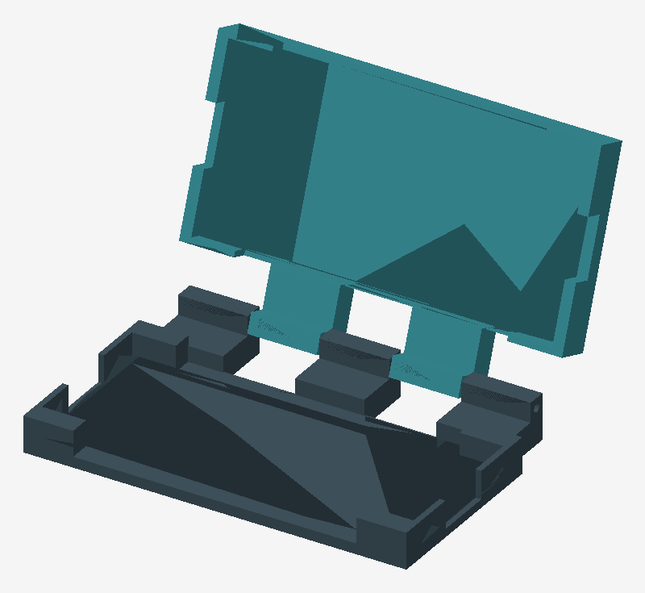

# iPhone 16e clamshell cyberdeck

Printable prototype: landscape iPhone above a Rii keyboard, with the screen and
keys facing each other when closed. Two rigid trays, an interleaved pin hinge,
and removable adhesive retention. Approximately **157 × 101.4 × 29.8 mm closed**.

**Keyboard fit is provisional.** The original Amazon description does not identify
the model, and its short link could not be resolved. These STLs assume a **Rii K06,
151 × 59 × 11 mm**, not the wider i4/i8. Confirm the label and measure the actual
keyboard, including its highest keys, before printing the trays.



## Print files

- [Keyboard tray](print/keyboard_tray.stl)
- [Phone tray](print/phone_tray.stl)
- [Keyboard footprint gauge](print/keyboard_fit_gauge.stl)
- [Phone footprint gauge](print/phone_fit_gauge.stl)
- [Hinge bore gauge](print/hinge_bore_gauge.stl)
- [3D assembly preview](assembly.glb) — reference only, do not slice as a print plate.

## Printing and assembly

1. Print the three gauges first. The device should fit inside its gauge without
   force; these check the bounding rectangle, not corner contours or thickness.
   Check a 3 mm rod passes through the hinge gauge. Adjust clearance if needed.
2. Print one of each tray with the broad outer back on the bed, pockets up, at
   100% scale in millimetres. Auto-arrange the phone tray (its Y coordinates start
   below zero). Each part fits a 157 × 102 mm bed area before brim.
3. Suggested starting settings: PETG, 0.4 mm nozzle, 0.2 mm layers, four walls,
   five top/bottom layers, 20% infill. PLA is suitable for checking the fit.
   The flat-bottom hinge blocks need no external support; the 3.4 mm horizontal
   bores require a short bridge. Inspect the slicer preview and test the gauge.
4. Dry-fit the devices. The phone is bare, with its camera end toward the relieved
   36 mm end of the pocket. The seat has 3.2 mm of camera clearance above the
   bottom skin. Check that the camera clears and the phone rests on its body.
   Broad side windows provide button access; end windows provide charging access.
   Connector, button and camera positions have not been measured on hardware.
5. Secure each device using thin removable adhesive pads on its back, away from
   the camera. The pockets have **no snap lips**: adhesive is required to retain
   the phone when the lid is upright. The nominal faces sit 1.5 mm below each
   rim, giving a 3 mm face-to-face gap closed. Pad thickness reduces this gap;
   keep it below 0.5 mm per device and verify clearance before closing.
6. Interleave the five knuckles and insert a smooth **3 mm × approximately 150 mm
   metal rod**. The knuckles span X=6.25 to 150.75 mm; a centred 150 mm rod remains
   inside the overall width. Retain both ends with small adhesive collars or tape
   stops after insertion, clear of the moving seams. Deburr the rod and bores.
7. Close slowly without forcing. Use an elastic band around the closed case for
   transport. The hinge is freely moving: hold or prop the screen in use. There
   is no friction mechanism, opening stop, integral latch or tabletop stability
   claim. Remove the phone for rear-camera photography.

The relatively broad hinge spine is deliberate: flat-bottom blocks are simple to
print and leave clearance through the opening sweep. This is a first prototype,
not a physically tested protective case. Check retention over a soft surface.

## Adjust and regenerate with uv

Edit `dimensions.json`, then run:

```sh
uv sync --locked
uv run generate.py
```

`uv.lock` pins the dependencies. `generate.py` is the editable parametric solid
source; it uses Manifold boolean operations and exports STL, GLB and previews.
No OpenSCAD or proprietary CAD application is needed. Lengths are in millimetres.
Phone width/depth refer to its landscape bounding rectangle. Changing dimensions
regenerates both tray sizes and their shared hinge.

The generator verifies each STL is a watertight, positive-volume connected solid
and checks tray-to-tray intersections at 5-degree increments from closed to 180
degrees. Results are in [validation.json](validation.json). This samples rigid CAD
clearance; it does not verify strength, real printing tolerances, device features,
adhesive retention, or collisions between actual devices and charging cables.

## Dimensions and existing designs

- [Apple iPhone 16e specifications](https://support.apple.com/en-us/122208):
  146.7 × 71.5 × 7.8 mm body; camera protrusion is additional.
- [Rii K06 manual](https://manuals.plus/m/ef73dbc4f88a9824dfdce77a1d5ca3ee4b891b0cf6bf45c259f6a767e2fcf977):
  151 × 59 × 11 mm. This is an assumed model, not an identification of your unit.
- [Mobile C-deck](https://hackaday.io/project/203116-mobile-c-deck): existing
  modular smartphone clamshell with downloadable models linked from the project;
  its listed keyboard differs, and an iPhone 16e insert was not verified.
- [CyberDeck Phone Stand Wireless v250602](https://3dgo.app/models/makerworld/1480774):
  another project described as using the Rii K06. Check the original listing,
  fit and licence before choosing it as a starting point.

This repository's geometry was created from scratch; no downloaded mesh is included.

Original keyboard description: Rii Mini Wireless Keyboard with Trackpad, IR Remote,
Small Keyboard for Home Entertainment, Smart TV, Mac, Laptop, Windows, Tablet,
Projector (2.4G+Bluetooth, Rechargeable, Backlit).
Original link: https://link.amazon/B0cayeWhN
